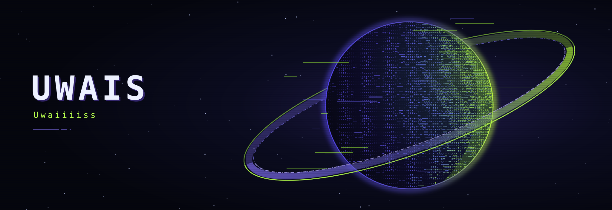
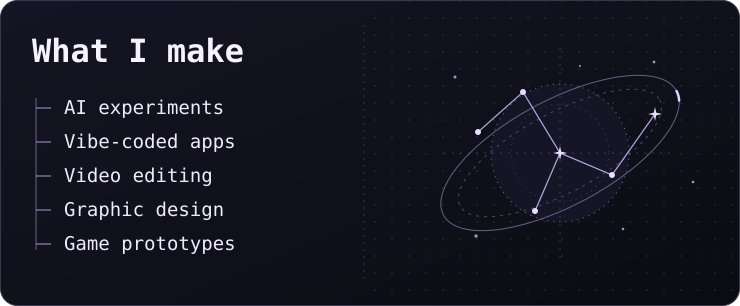

<p align="center">
  
</p>

<p align="center">
  <a href="https://github.com/Uwaiiiiss?tab=repositories">projects</a>
  &nbsp;·&nbsp;
  <a href="https://github.com/Uwaiiiiss#js-contribution-activity-description">activity</a>
  &nbsp;·&nbsp;
  <a href="https://www.linkedin.com/in/mohammad-uwais-a1b46a3b6/">linkedin</a>
  &nbsp;·&nbsp;
  <a href="https://www.instagram.com/uwaiiiiss_/">instagram</a>
</p>

```text
                 .        *                 .
        *                 .       .
              .-───────────────-.
           .-'    U W A I S       '-.
         .'   make something / see     '.
        /    what happens / repeat       \
       ;                                 ;
       |   idea  ──▶  first version      |
       ;   first version  ──▶  better    ;
        \                                 /
         '.       .             *       .'
           '-.______________________.-'
                    ◜  ◝
                   ◟    ◞
```

# Mohammad Uwais

I get an idea and usually end up trying to build it.

I make small things across a few different surfaces: AI experiments, vibe-coded apps, video edits, graphic design, and game prototypes. The common thread is simple: start with a rough version, find the part that clicks, then keep going until it feels like mine.

<p align="center">
  
</p>

## Current orbit

<table>
  <tr>
    <td width="50%" valign="top">
      <strong>building</strong><br />
      <a href="https://github.com/Uwaiiiiss/LastNote">LastNote</a><br />
      <sub>a place for thoughts that should not disappear</sub>
    </td>
    <td width="50%" valign="top">
      <strong>learning</strong><br />
      game development<br />
      <sub>making prototypes feel good to play, not only good to look at</sub>
    </td>
  </tr>
  <tr>
    <td width="50%" valign="top">
      <strong>always nearby</strong><br />
      motion · type · layout<br />
      <sub>the details that make a first version feel finished</sub>
    </td>
    <td width="50%" valign="top">
      <strong>on GitHub</strong><br />
      <a href="https://github.com/Uwaiiiiss?tab=repositories">all repositories</a><br />
      <sub>experiments, prototypes, and the occasional rabbit hole</sub>
    </td>
  </tr>
</table>

## A few things I like

```text
01  making the first version before the idea gets overthought
02  turning a messy thought into something you can click
03  finding the cut, color, or line that makes a piece work
04  learning by shipping small and paying attention
```

<p align="center">
  
</p>

<p align="center">
  <sub>There is probably a new experiment somewhere in the orbit.</sub>
</p>
