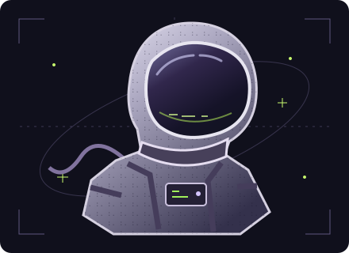

  

<h1 align="center">Hey, I’m Uwais.</h1>

<strong>Game prototypes &amp; creative coding</strong>

## About me

I like building small games and figuring out how they should feel. Sometimes that means tuning movement in Unity. Sometimes it means spending too long getting a planet to look right with a handful of monospace characters.

Right now I’m experimenting with game mechanics and animated graphics.

 

<h2 align="center">Connect</h2>

  <a href="https://github.com/Uwaiiiiss?tab=repositories"><kbd>GitHub</kbd></a> &nbsp;
  <a href="https://www.linkedin.com/in/mohammad-uwais-a1b46a3b6/"><kbd>LinkedIn</kbd></a> &nbsp;
  <a href="https://www.instagram.com/uwaiiiiss_/"><kbd>Instagram</kbd></a>

## Tools & techniques

`Unity` &nbsp; `Git` &nbsp; `SVG animation` &nbsp; `ASCII art`

## Featured project

**[ASCII Orbit](https://github.com/Uwaiiiiss/Uwaiiiiss/blob/main/orbit.svg)** · The banner at the top of this page. The planet’s surface is drawn with monospace glyphs, and the satellite follows an elliptical path through its rings.

## GitHub activity

[View my contribution graph ↗](https://github.com/Uwaiiiiss#js-contribution-activity-description)
