  

text
 _   _ _      _____ _____ ____
| | | | |    |  _  |_   _/ ___|
| | | | | /\ | |_| | | | \___ \
| |_| | |/  \|  _  |_| |_ ___) |
 \___/|__/\__|_| |_|_____|____/     // mohammad uwais
text
+--[ about.sh ]-----------------------------------------+
|                                                       |
|   user      uwais@night                               |
|   pronouns  he/him                                    |
|   shell     insomnia 5.0                              |
|   uptime    since the first night code ran            |
|   building  [ write your real project here ]          |
|   learning  [ write what you study now ]              |
|   quote     "look up at the stars, not at your feet"  |
|                                                       |
+-------------------------------------------------------+
text
$ ls ~/stack
html/  css/  js/  ts/  react/  node/  python/  git/
text
$ ./find_me.sh
  [01]  github     github.com/Uwaiiiiss
  [02]  linkedin   in/mohammad-uwais-a1b46a3b6
  [03]  instagram  @uwaiiiiss_

<a href="https://github.com/Uwaiiiiss?tab=repositories">[ projects ]</a>   <a href="https://www.linkedin.com/in/mohammad-uwais-a1b46a3b6">[ linkedin ]</a>   <a href="https://instagram.com/uwaiiiiss_">[ instagram ]</a>

  

  

<code>exit 0</code>  //  see you after dark

