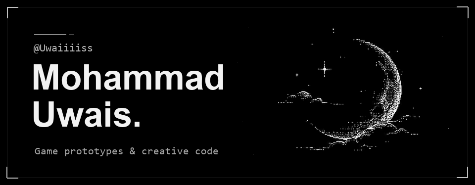

  <a href="https://github.com/Uwaiiiiss?tab=repositories"><strong>Projects ↗</strong></a> &nbsp; / &nbsp;
  <a href="https://github.com/Uwaiiiiss#js-contribution-activity-description">Activity</a> &nbsp; / &nbsp;
  <a href="https://www.linkedin.com/in/mohammad-uwais-a1b46a3b6/">LinkedIn</a> &nbsp; / &nbsp;
  <a href="https://www.instagram.com/uwaiiiiss_/">Instagram</a>

## In the workshop

Heyy. I’m Uwais. I make small games and mess around with pixel art. I like working on the little things you feel before you can name them, like how a jump lands or how a scene moves.

<strong>The crescent loop</strong>

The banner uses all nine frames of the [original moon GIF](./Twinkling%20Crescent%20Moon%20Grid.gif). I kept the black sky and the white stippling. The stars move while the lettering stays still.

[View the original loop ↗](./Twinkling%20Crescent%20Moon%20Grid.gif)

<strong>Tools I reach for</strong>

**Unity** for game prototypes, **pixel art** for small visual studies, and **Git** to keep track of what changed between experiments.

